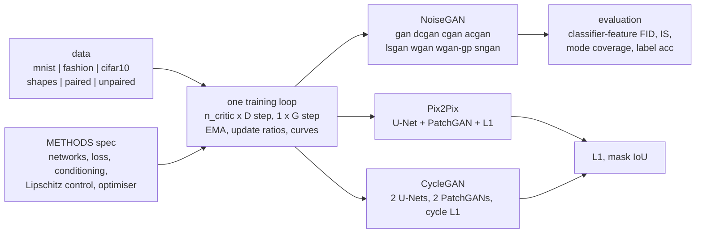

# gan-workbench

**Ten GAN variants for images in plain PyTorch, built to understand how each one works: the
original GAN, DCGAN, conditional GAN, ACGAN, LSGAN, WGAN, WGAN-GP, SNGAN (hinge + spectral
norm), pix2pix and CycleGAN. They share one training loop, one data pipeline and one
evaluation, so switching method is one flag and the comparison is fair: same data, same
budget, same metrics (a classifier-feature FID, an Inception-Score analogue, mode coverage),
with tests, runnable examples and a Kaggle/Colab notebook for the longer GPU runs.**

[](LICENSE)
[](pyproject.toml)
[](https://pytorch.org)
[](docs/testing.md)

The networks are small on purpose (0.1-3 M parameters): the point is to watch each mechanism
work on a CPU in minutes, then run the same code longer on a free GPU.



| method | `--method` | how it works, in one line | code |
|---|---|---|---|
| GAN | `gan` | MLPs; D is a real/fake classifier, G maximises log D(G(z)) (non-saturating; `--saturating` for the original) | `methods.NoiseGAN`, `models.MLPGenerator` |
| DCGAN | `dcgan` | same loss with strided (transposed) convolutions, BatchNorm, LeakyReLU, β₁ = 0.5 | `models.DCGenerator`, `models.DCDiscriminator` |
| conditional GAN | `cgan` | label concatenated to z for G and stacked as channel maps for D: D judges (image, label) pairs | `NoiseGAN`, `DCDiscriminator(n_classes=)` |
| ACGAN | `acgan` | label to G; D has a real/fake head and a class head, both nets add a cross-entropy | `DCDiscriminator(aux_classes=)` |
| LSGAN | `lsgan` | least-squares loss: confident-but-wrong fakes still get gradient | `losses.d_loss("ls")` |
| WGAN | `wgan` | critic estimates the Wasserstein-1 distance; Lipschitz by weight clipping, 5 critic steps, RMSprop | `losses.d_loss("wgan")`, clipping in `NoiseGAN.d_step` |
| WGAN-GP | `wgan-gp` | same critic, Lipschitz by a gradient penalty on real/fake interpolates, no BatchNorm | `losses.gradient_penalty` |
| SNGAN | `sngan` (`hinge`) | hinge loss, every D layer divided by its largest singular value | `DCDiscriminator(norm="spectral")` |
| pix2pix | `pix2pix` | paired image → image: U-Net G, conditional PatchGAN D, + 100 · L1 | `methods.Pix2Pix`, `models.UNetGenerator`, `models.PatchDiscriminator` |
| CycleGAN | `cyclegan` | unpaired A ↔ B: two G, two PatchGAN D, LSGAN loss + 10 · cycle L1 | `methods.CycleGAN` |

Shared tricks, as flags of the same loop: `--label-smoothing`, `--ttur`, `--n-critic`, `--ema`,
`--r1`, `--feature-matching`, `--saturating`. Each method's equations, shapes and the reason
it exists are in [docs/architecture.md](docs/architecture.md).

## Quick start

```bash
git clone https://github.com/benisalla/gan-workbench && cd gan-workbench
uv venv .venv && VIRTUAL_ENV=.venv uv pip install -e ".[dev]"     # or: pip install -e ".[dev]"
source .venv/bin/activate

gans-data mnist                                              # 11 MB download + preview grid
gans-train --method wgan-gp --dataset mnist --steps 1000     # any of the ten types
gans-sample checkpoints/wgan-gp/last.pt --interpolate --out walk.png
gans-eval checkpoints/wgan-gp/last.pt                        # classifier-feature FID, IS, modes
gans-train --method pix2pix --steps 1500                     # offline paired shapes: photo -> mask
```

Everything also works offline: `--dataset shapes` for the noise-to-image methods, and the
image-to-image methods default to their synthetic sets. `pytest -q` runs the tests in about a
minute and a half on one CPU thread.

## Examples

[`examples/`](examples/README.md) holds six numbered scripts that use the package from
Python, each one command with small CPU defaults: train a DCGAN, train any type by name,
conditional cGAN vs ACGAN on MNIST, evaluation and latent interpolation, pix2pix photo → mask,
CycleGAN on unpaired shapes.

```bash
python examples/01_train_dcgan.py && python examples/02_train_any_method.py --method lsgan
```

RESULTS_SECTION

## Repository layout

```
src/gans/
  config.py     TrainConfig: one dataclass for every method (None fields -> method defaults)
  data.py       MNIST / FashionMNIST / CIFAR-10 + three offline synthetic sets; gans-data
  models.py     MLP, DCGAN, U-Net and PatchGAN networks; D returns (logit, features, class logits)
  losses.py     bce / ls / wgan / hinge losses, gradient penalty, R1, feature matching
  methods.py    METHODS table + NoiseGAN, Pix2Pix, CycleGAN (one D step, one G step each)
  train.py      the one training loop, EMA, update ratios, checkpoints; gans-train
  metrics.py    evaluation classifier, Frechet distance, IS analogue, mode coverage, IoU
  evaluate.py   evaluate a checkpoint, real-vs-real baseline; gans-eval
  sample.py     sample grids, per-class grids, interpolations, translations; gans-sample
  viz.py        live_plot_gan curves, grids, comparisons
tests/          42 fast CPU tests, incl. "DCGAN learns a single image" and "pix2pix overfits a batch"
examples/       01-06 runnable scripts
scripts/        compare_all.py (trains + evaluates + copies figures), results_table.py
notebooks/      build_notebook.py -> train_colab_kaggle.ipynb (GPU: MNIST, CIFAR-10, Facades)
docs/           architecture, training, evaluation, data, testing
legacy/         the original coursework notebooks + what was fixed
assets/         figures and result JSON from the local runs
```

## Documentation

* [docs/architecture.md](docs/architecture.md): every method, its loss, its networks, why it exists
* [docs/training.md](docs/training.md): the loop, the curves and what they mean, failure modes to try
* [docs/evaluation.md](docs/evaluation.md): classifier-feature FID / IS, mode coverage, image-to-image metrics
* [docs/data.md](docs/data.md): datasets, the synthetic generators and why they exist
* [docs/testing.md](docs/testing.md): what each test checks

## Legacy notebooks

[`legacy/`](legacy/README.md) keeps the two Centrale coursework notebooks this repo grew
from: a DCGAN on MNIST (with the `live_plot_gan` and `compute_update_ratio` helpers) and a
pix2pix U-Net + PatchGAN on CMP Facades. Their README lists eleven issues found and how the
package fixes them; the main one is that the first notebook's optimisers were built for
networks that were then replaced, so the trained GAN never received an update.

## License

MIT, see [LICENSE](LICENSE).
