# gan-workbench

**Ten GAN variants for images in plain PyTorch, built to understand how each one works: the
original GAN, DCGAN, conditional GAN, ACGAN, LSGAN, WGAN, WGAN-GP, SNGAN (hinge + spectral
norm), pix2pix and CycleGAN. They share one training loop, one data pipeline and one
evaluation, so switching method is one flag and the comparison is fair: same data, same
budget, same metrics (a classifier-feature FID, an Inception-Score analogue, mode coverage),
with tests, runnable examples and a Kaggle/Colab notebook for the longer GPU runs.**

[](LICENSE)
[](pyproject.toml)
[](https://pytorch.org)
[](docs/testing.md)

## Before and after training

The problem: an untrained generator outputs flat grey for every z. Its N(0, 0.02) weights keep
the final tanh near 0. Each panel below uses the
**same fixed z** (and, for cGAN, the same labels: digits 0-9 then 0-5) at step 0 and at the end
of a short CPU run on MNIST. The GIF replays the same z through snapshots taken during
those runs.

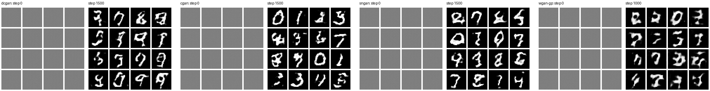

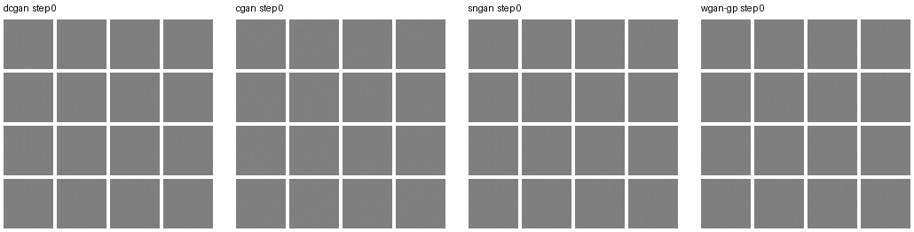

pix2pix on held-out test photos. In each block the rows are the input photo, the generator's
output and the true mask, at step 0 and after 800 steps:

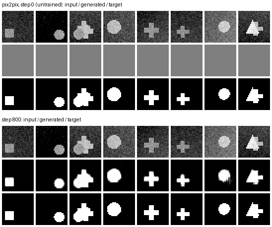

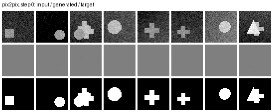

To regenerate these, run `python scripts/make_progress.py` (trains with snapshots, about 15 min on
a CPU) or `--from-saved` to redraw from `assets/progress/*.pt`.

The networks are small on purpose (0.1-3 M parameters): the point is to watch each mechanism
work on a CPU in minutes, then run the same code longer on a free GPU.

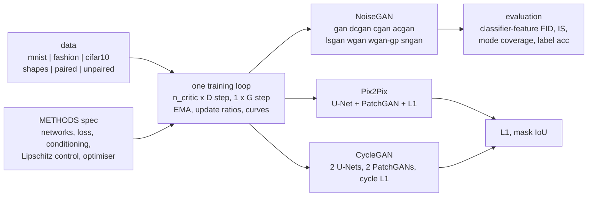

| method | `--method` | how it works, in one line | code |
|---|---|---|---|
| GAN | `gan` | MLPs; D is a real/fake classifier, G maximises log D(G(z)) (non-saturating; `--saturating` for the original) | `methods.NoiseGAN`, `models.MLPGenerator` |
| DCGAN | `dcgan` | same loss with strided (transposed) convolutions, BatchNorm, LeakyReLU, β₁ = 0.5 | `models.DCGenerator`, `models.DCDiscriminator` |
| conditional GAN | `cgan` | label concatenated to z for G and stacked as channel maps for D: D judges (image, label) pairs | `NoiseGAN`, `DCDiscriminator(n_classes=)` |
| ACGAN | `acgan` | label to G; D has a real/fake head and a class head, both nets add a cross-entropy | `DCDiscriminator(aux_classes=)` |
| LSGAN | `lsgan` | least-squares loss: confident-but-wrong fakes still get gradient | `losses.d_loss("ls")` |
| WGAN | `wgan` | critic estimates the Wasserstein-1 distance; Lipschitz by weight clipping, 5 critic steps, RMSprop | `losses.d_loss("wgan")`, clipping in `NoiseGAN.d_step` |
| WGAN-GP | `wgan-gp` | same critic, Lipschitz by a gradient penalty on real/fake interpolates, no BatchNorm | `losses.gradient_penalty` |
| SNGAN | `sngan` (`hinge`) | hinge loss, every D layer divided by its largest singular value | `DCDiscriminator(norm="spectral")` |
| pix2pix | `pix2pix` | paired image → image: U-Net G, conditional PatchGAN D, + 100 · L1 | `methods.Pix2Pix`, `models.UNetGenerator`, `models.PatchDiscriminator` |
| CycleGAN | `cyclegan` | unpaired A ↔ B: two G, two PatchGAN D, LSGAN loss + 10 · cycle L1 | `methods.CycleGAN` |

Shared tricks, as flags of the same loop: `--label-smoothing`, `--ttur`, `--n-critic`, `--ema`,
`--r1`, `--feature-matching`, `--saturating`. Each method's equations, shapes and the reason
it exists are in [docs/architecture.md](docs/architecture.md).

## Quick start

```bash
git clone https://github.com/benisalla/gan-workbench && cd gan-workbench
uv venv .venv && VIRTUAL_ENV=.venv uv pip install -e ".[dev]"     # or: pip install -e ".[dev]"
source .venv/bin/activate

gans-data mnist                                              # 11 MB download + preview grid
gans-train --method wgan-gp --dataset mnist --steps 1000     # any of the ten types
gans-sample checkpoints/wgan-gp/last.pt --interpolate --out walk.png
gans-eval checkpoints/wgan-gp/last.pt                        # classifier-feature FID, IS, modes
gans-train --method pix2pix --steps 1500                     # offline paired shapes: photo -> mask
```

Everything also works offline: `--dataset shapes` for the noise-to-image methods, and the
image-to-image methods default to their synthetic sets. `pytest -q` runs the tests in about a
minute and a half on one CPU thread.

## Examples

[`examples/`](examples/README.md) holds six numbered scripts that use the package from
Python, each one command with small CPU defaults: train a DCGAN, train any type by name,
conditional cGAN vs ACGAN on MNIST, evaluation and latent interpolation, pix2pix photo → mask,
CycleGAN on unpaired shapes.

```bash
python examples/01_train_dcgan.py && python examples/02_train_any_method.py --method lsgan
```

## Results

These are **short CPU runs**: one thread on a shared 8-core machine, `--width 32`, batch 64,
the default hyper-parameters of each method. They show that every method trains through
the shared loop and how the methods differ. They are not benchmarks; the notebook runs the same code longer on a GPU.
The times are wall-clock and depend on machine load: `dcgan`, `cgan` and `acgan` ran while the
machine had a load average of about 20, and the later runs had a load of about 5, so compare
FID and samples, not minutes.

### MNIST, 28 px, 2 000 generator steps each

Classifier-feature FID / IS: computed with a small CNN trained on MNIST (98.6% test accuracy),
**not Inception**, on 5 000 samples vs 5 000 test images ([docs/evaluation.md](docs/evaluation.md)).
The last row is the floor: real training images against real test images.

| method | G / D params | steps | time | FID (clf) ↓ | IS (clf) ↑ | modes ↑ | label acc |
|---|---|---|---|---|---|---|---|
| `gan` | 0.24 M / 0.23 M | 2000 | 0.7 min | 399.25 | 3.36 | 10/10 | - |
| `dcgan` | 0.24 M / 0.04 M | 2000 | 7.2 min | 93.82 | 5.09 | 10/10 | - |
| `cgan` | 0.27 M / 0.04 M | 2000 | 9.7 min | 29.64 | 8.02 | 10/10 | 87.5% |
| `acgan` | 0.27 M / 0.07 M | 2000 | 7.8 min | 44.09 | 8.71 | 10/10 | 93.9% |
| `lsgan` | 0.24 M / 0.04 M | 2000 | 2.7 min | 146.76 | 4.44 | 8/10 | - |
| `sngan` | 0.24 M / 0.04 M | 2000 | 3.0 min | 57.46 | 5.65 | 10/10 | - |
| `wgan` | 0.24 M / 0.04 M | 2000 | 8.4 min | 1035.54 | 1.61 | 6/10 | - |
| `wgan-gp` | 0.24 M / 0.04 M | 1500 | 10.2 min | 127.23 | 4.43 | 10/10 | - |
| *real train images* | - | - | - | 9.81 | 9.38 | 10/10 | - |

WGAN and WGAN-GP do 5 critic steps per generator step, so 2 000 G steps cost them 10 000 D
steps. WGAN-GP got 1 500 G steps (7 500 critic steps) to stay inside a 25-minute run.

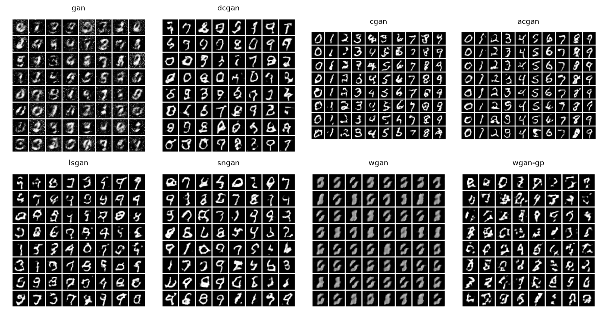

What the runs show:

* **Conditioning is the biggest win.** `cgan` (FID 29.6) and `acgan` (44.1) are far ahead of
  every unconditional method, because the label removes the hardest part of the problem
  (choosing which digit to draw). The classifier agrees with the requested digit 87.5% / 93.9%
  of the time. ACGAN's class head gives more readable digits (higher IS, higher label
  accuracy) but a worse FID than cGAN: its digits vary less within a class.
* **Convolutions matter more than the loss.** The MLP `gan` (FID 399) makes noisy but
  recognisable digits; `dcgan`, with the same loss and a similar parameter count, reaches 94.
* **Spectral norm + hinge (`sngan`, 57.5)** is the best unconditional method here and was
  one of the fastest per step: Lipschitz control without an extra backward pass.
* **`lsgan` (147, 8/10 modes)** is the only method that lost classes in this run. The
  least-squares loss does not protect against mode dropping.
* **`wgan` with weight clipping did not train in this budget (FID 1036, 6 classes)**. The
  samples are grey, and nearly every z gives the same shape. Clipping to ±0.01 leaves the
  critic too little capacity to say anything useful, and RMSprop at 5e-5 is slow. This is the
  failure that WGAN-GP was designed to fix.
* **`wgan-gp` (127, 10/10)** learns digits with the same networks once clipping is replaced by
  the gradient penalty. Its critic score D(G(z)) is unbounded and swings widely early on. It
  needs more generator steps than the others, and each step costs about 5× more on a CPU.

| curves (`live_plot_gan`) | |
|---|---|
| 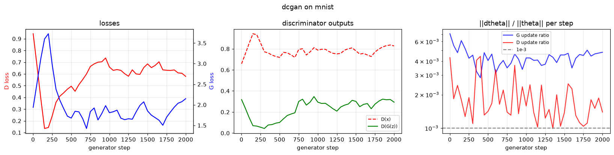 | 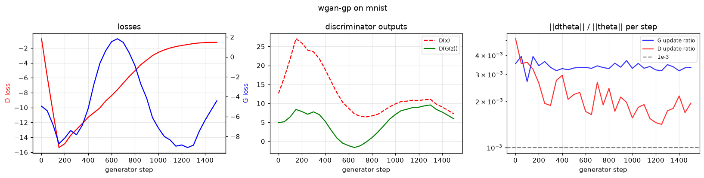 |

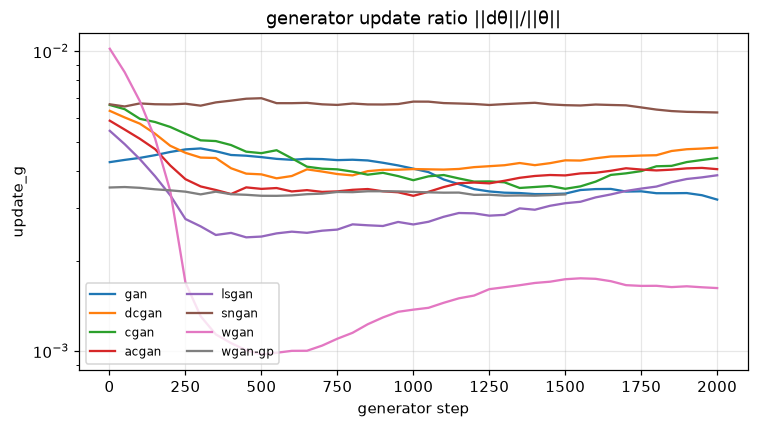

Latent interpolations, one straight line in z per row (cGAN: the label is fixed per row):

| dcgan | cgan |
|---|---|
| 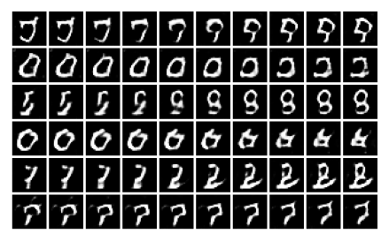 | 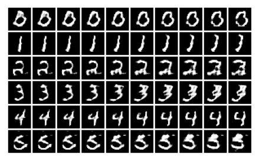 |

### Image-to-image on synthetic shapes, 32 px

| method | G / D params | steps | time | L1 ↓ | mask IoU ↑ | cycle L1 ↓ |
|---|---|---|---|---|---|---|
| `pix2pix` | 0.39 M / 0.04 M | 1200 | 3.2 min | 0.019 | 0.977 | - |
| `cyclegan` | 0.77 M / 0.09 M | 600 | 4.0 min | 0.308 | 0.255 | 0.040 |
| `cyclegan-2000` | 0.77 M / 0.09 M | 2000 | 11.9 min | 0.239 | 0.280 | 0.013 |

`pix2pix` learns the photo → mask mapping almost perfectly (test IoU 0.977), because its
input and target are paired and the L1 term gives a direct target. Rows: input photo, true
mask, predicted mask.

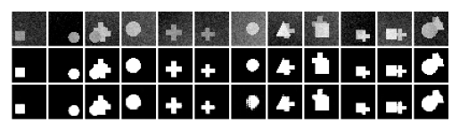

`cyclegan` is the hard case, and it is only partly solved after 2 000 steps (12 min). The cycle
error is tiny (0.013), but IoU against the true outline is only 0.28. The figure below shows why
(rows: a, G_AB(a), G_BA(G_AB(a)), true outline). G_AB already draws outlines, but it fills them
with a faint high-frequency pattern. G_BA reads that pattern back to rebuild the filled shape.
This is CycleGAN's known "steganography" shortcut: the cycle loss only requires the round trip
to be invertible, and hiding the information is easier than learning the real mapping. It is
then up to D_B to notice the pattern and penalise it, which takes many more steps. The paired
L1 loss of pix2pix never allows this shortcut.

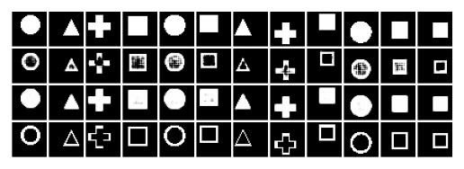


## Repository layout

```
src/gans/
  config.py     TrainConfig: one dataclass for every method (None fields -> method defaults)
  data.py       MNIST / FashionMNIST / CIFAR-10 + three offline synthetic sets; gans-data
  models.py     MLP, DCGAN, U-Net and PatchGAN networks; D returns (logit, features, class logits)
  losses.py     bce / ls / wgan / hinge losses, gradient penalty, R1, feature matching
  methods.py    METHODS table + NoiseGAN, Pix2Pix, CycleGAN (one D step, one G step each)
  train.py      the one training loop, EMA, update ratios, checkpoints; gans-train
  metrics.py    evaluation classifier, Frechet distance, IS analogue, mode coverage, IoU
  evaluate.py   evaluate a checkpoint, real-vs-real baseline; gans-eval
  sample.py     sample grids, per-class grids, interpolations, translations; gans-sample
  viz.py        live_plot_gan curves, grids, comparisons
tests/          43 fast CPU tests, incl. "DCGAN learns a single image" and "pix2pix overfits a batch"
examples/       01-06 runnable scripts
scripts/        compare_all.py (train + evaluate + figures), results_table.py, make_progress.py (before/after, GIFs)
notebooks/      build_notebook.py -> train_colab_kaggle.ipynb (GPU: MNIST, CIFAR-10, Facades)
docs/           architecture, training, evaluation, data, testing
legacy/         the original coursework notebooks + what was fixed
assets/         figures and result JSON from the local runs
```

## Documentation

* [docs/architecture.md](docs/architecture.md): every method, its loss, its networks, why it exists
* [docs/training.md](docs/training.md): the loop, the curves and what they mean, failure modes to try
* [docs/evaluation.md](docs/evaluation.md): classifier-feature FID / IS, mode coverage, image-to-image metrics
* [docs/data.md](docs/data.md): datasets, the synthetic generators and why they exist
* [docs/testing.md](docs/testing.md): what each test checks

## Legacy notebooks

[`legacy/`](legacy/README.md) keeps the two Centrale coursework notebooks this repo grew
from: a DCGAN on MNIST (with the `live_plot_gan` and `compute_update_ratio` helpers) and a
pix2pix U-Net + PatchGAN on CMP Facades. Their README lists eleven issues found and how the
package fixes them; the main one is that the first notebook's optimisers were built for
networks that were then replaced, so the trained GAN never received an update.

## License

MIT, see [LICENSE](LICENSE).
